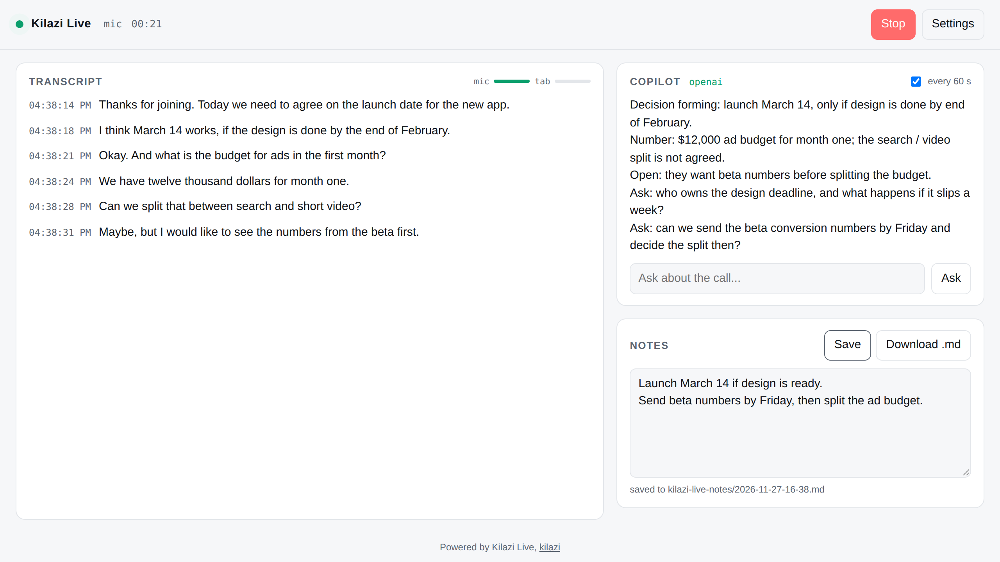

# kilazi-live
Writes a live transcript of your calls in your browser, and an AI copilot reads along and suggests what to say next.



Demo call: the real page and server, with a stand-in transcription endpoint and made-up lines.

```
npx github:kilazi/kilazi-live
```

It opens a page on your computer: paste your OpenAI key in Settings (it runs the transcription), press Start, pick the call's Chrome tab and tick "Also share tab audio".
Needs Node 18+ and Chrome. Notes save as markdown in `./kilazi-live-notes`. Copilot can also be Claude Code or Codex: add `--provider claude`.

## Why not Otter, Fireflies and the like?
Those are hosted services with a subscription, and usually a bot that joins your call. kilazi-live is open source: a small Node server on your machine and a page in your Chrome that hears the call through the tab's audio, so nothing joins the call.
Transcription uses your own OpenAI key, sent from your machine straight to OpenAI. Notes are plain markdown on your disk.
The copilot can be OpenAI, Claude Code or Codex running on your own login (API keys are stripped from their environment), or any HTTP endpoint you point it at.

Apache-2.0. Reusing it? Keep the NOTICE: credit kilazi/kilazi-live.

More (hosting, access codes, Docker): https://kilazi.com/wiki/kilazi-live/ · by kilazi
